# PayGuard AI

AI agent that reviews a seller's PayPal payments for fraud, explains every
alert in plain English, and proposes an action. The seller confirms before
anything happens on PayPal. Built for the PayPal AI Hackathon.

## For judges: try it in 2 minutes

Nothing to install. Everything runs on the **PayPal sandbox**: no real money.

- **App (seller dashboard):** https://payguard-ai-1p86.onrender.com
- **Demo shop (buyer side):** https://payguard-ai-1p86.onrender.com/shop/

The app is on Render's free plan: if it has been idle, the first visit takes
about a minute to wake up.

1. **Start clean.** In the left sidebar, click **🧹 Reset demo**, then **Yes, reset**.
   This empties PayGuard's own ledger only; nothing is changed on PayPal.
2. **Create payments.** Click **⚡ Simulate payments**. About 20 seconds later,
   10 real sandbox payments are listed: 6 low, 2 medium and 2 high risk.
3. **Open an alert.** Click a row in the table (for example a *Medium* one).
   On the right: the 0–100 score, the plain-English reason written by the
   LLM (every number checked), the top SHAP reasons and PayGuard's proposal.
4. **Let the agent work.** Click **🤖 Let the agent review the queue**. The
   agent summarises its plan for all pending payments, e.g. *"2 to refund, 2
   to monitor, 6 to approve, estimated loss avoided: $2,415.14"*.
5. **Apply the plan.** Click **✅ Apply this plan**: approvals and monitors are
   recorded at once. A second dialog lists the refunds; click **Yes, refund
   them** to send them to PayPal (or **Not now**).
6. **Ask the AI agent.** In **💬 Ask PayGuard**, click *Review today's payments
   and protect me from fraud* (or type your own question, e.g. *Why was the
   tent order flagged?*). Watch its steps: which tool it calls and what comes
   back. It proposes refunds as buttons; nothing is refunded until you click
   and confirm.
7. **Buy something yourself.** Click **🛍️ Open demo shop**, pick an item, click
   the PayPal button and log in with the sandbox buyer account below. Go back
   to the dashboard: your payment appears by itself within a few seconds,
   scored, with a **✓ PayPal webhook** badge once PayPal's signed webhook is
   verified.

**Sandbox buyer account for judges** (also shown on the shop page):

| | |
|---|---|
| Email | `sb-8vqyj53636163@personal.example.com` |
| Password | `PayGuardJudge1!` |

> ⚠️ This is a **PayPal sandbox test account**: it only works on
> sandbox.paypal.com, holds no real money and has no real card. Never type a
> real PayPal login in this demo.

All visitors share one demo ledger: if someone else is testing at the same
time, their payments appear too. **Reset demo** gives you a clean start.

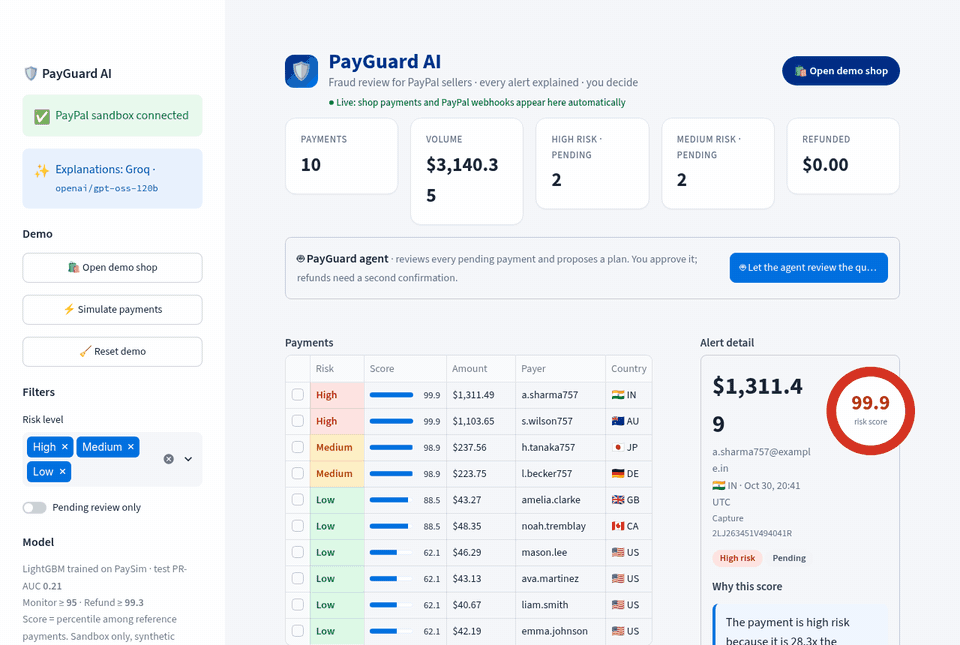

<details><summary>Step-by-step screenshots</summary>

| | |
|---|---|
| 2. Ten simulated payments, scored | 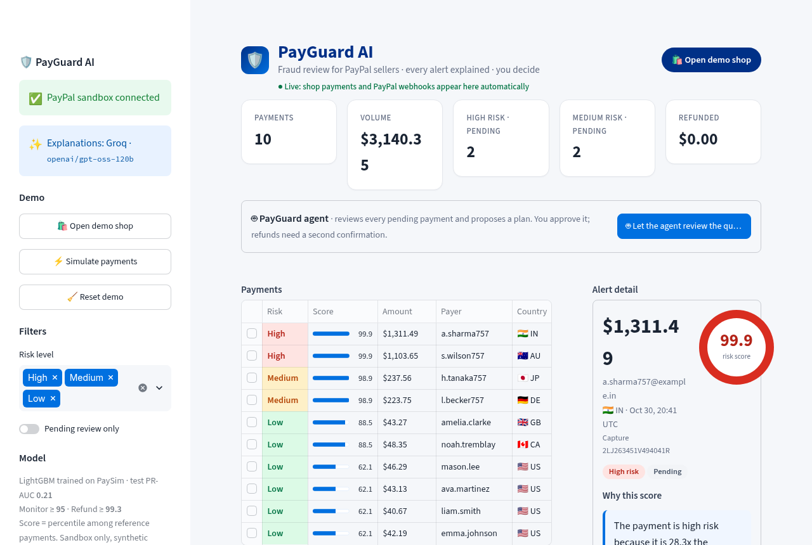 |
| 3. An alert, explained | 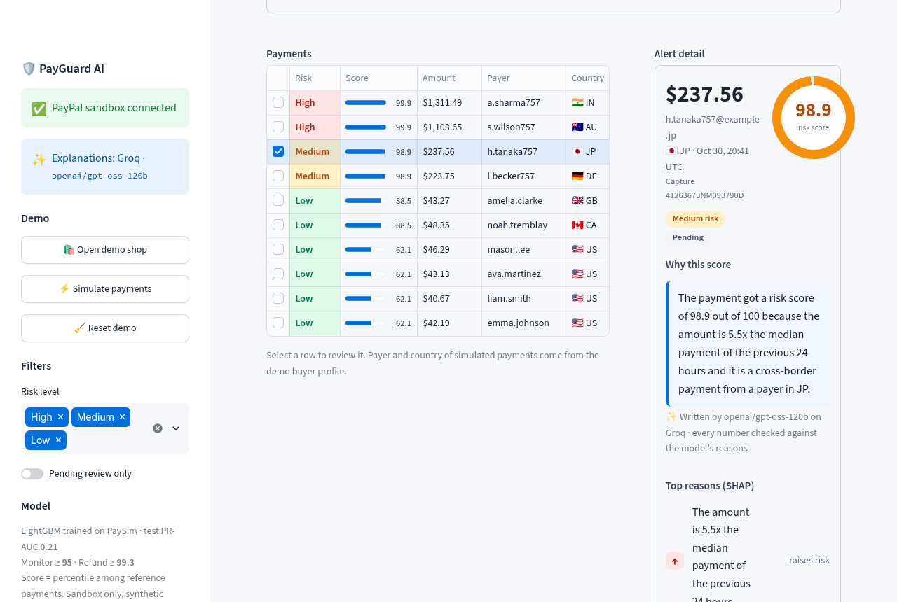 |
| 4. The agent's plan for the whole queue | 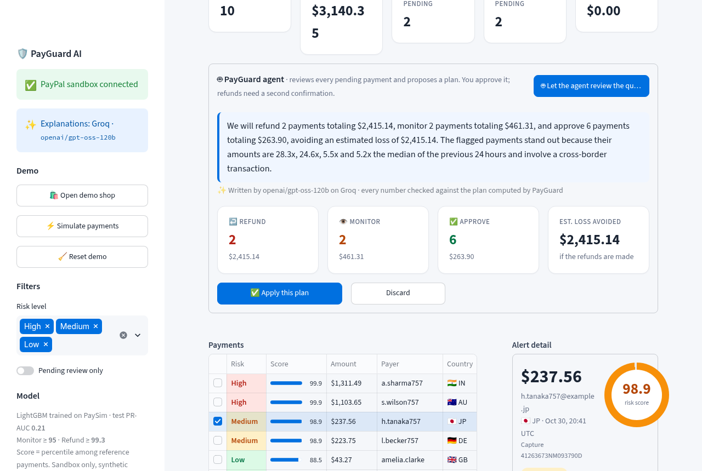 |
| 5. Refunds need a second confirmation | 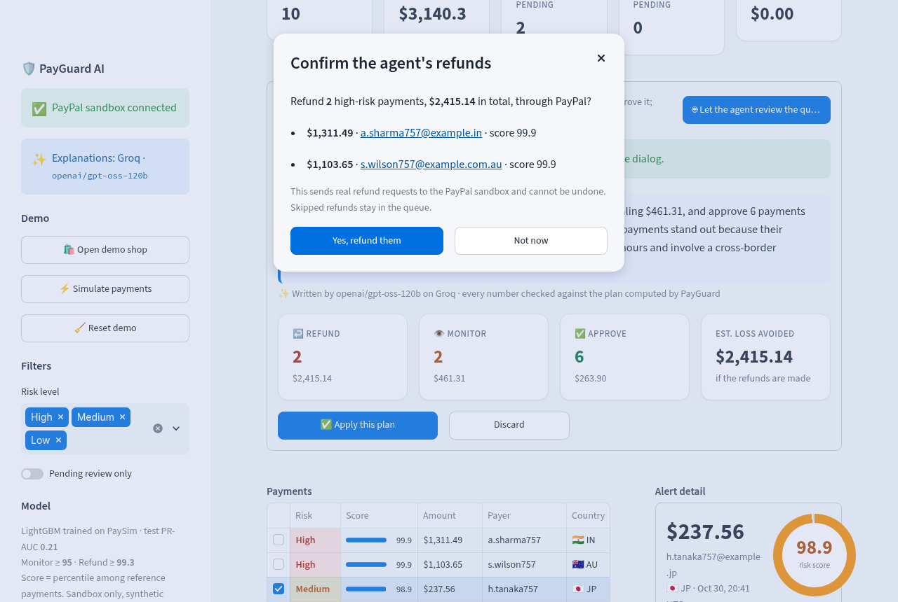 |
| 7. The demo shop (PayPal buttons) | 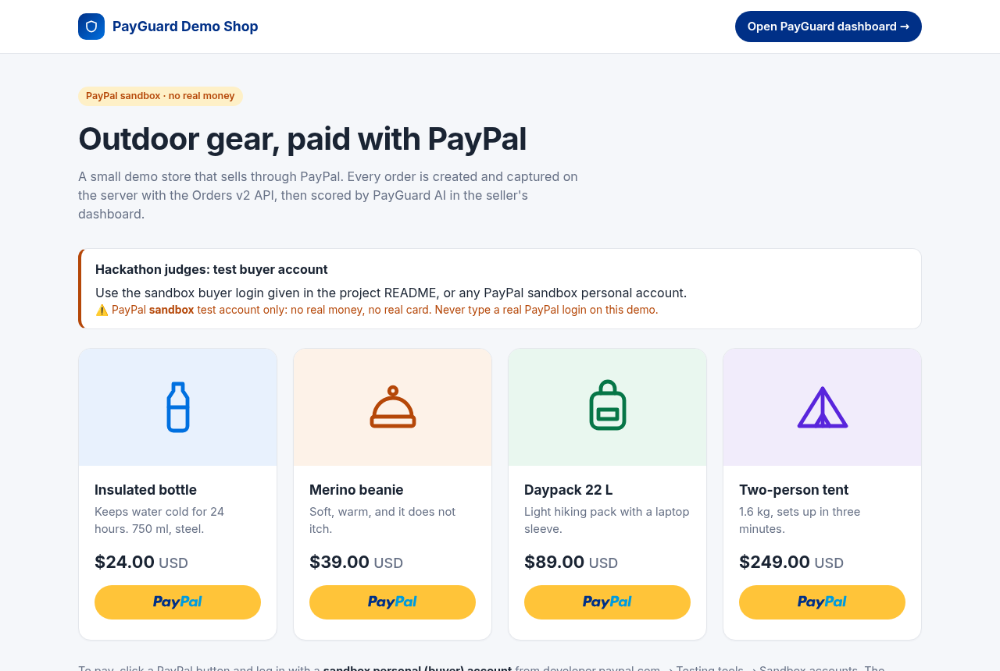 |
| 1. Reset demo, with confirmation | 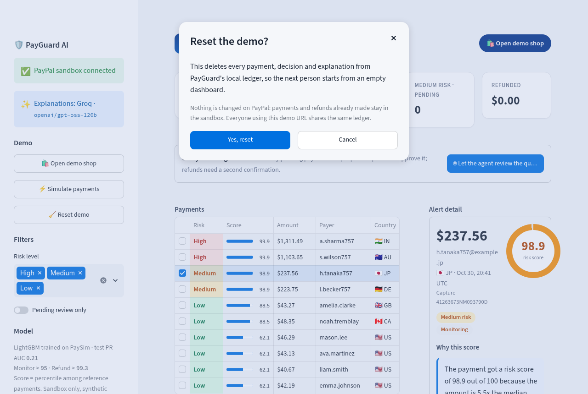 |

If PayPal refuses a refund (for example when the sandbox seller's balance is
too low), PayGuard says so plainly, nothing is refunded and the payment stays
in the queue:

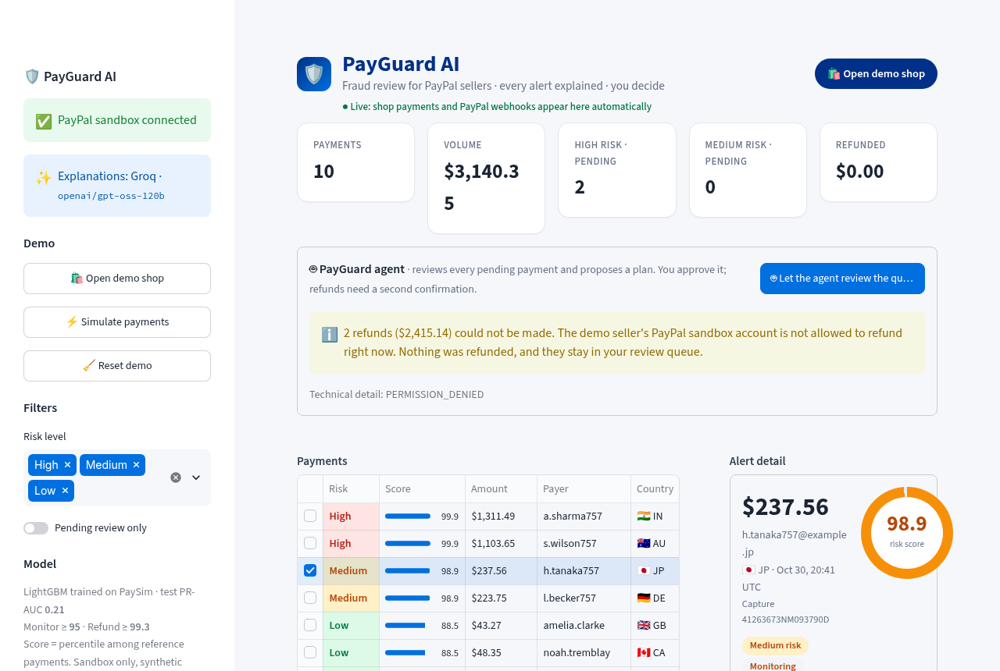

</details>

## Features

- **Risk score 0–100** for every payment (LightGBM)
- **Up to 3 reasons** per alert (SHAP), plus **one plain-English sentence** written
  by an LLM on Groq, with every number checked against those reasons
- **Agent proposal**: approve, monitor or refund. Refunds go through the
  PayPal REST API only after the seller confirms.
- **Agent reviews the whole queue**: one click gives a plan ("2 payments to
  refund, 2 to monitor, 6 to approve, estimated loss avoided: $2,415.14"), with
  numbers computed by the code and checked in the LLM's text; the seller
  applies it in one click and confirms refunds separately
- **Ask PayGuard, an LLM agent with tools**: the seller asks a question or
  gives an instruction in plain English; the agent (Groq function calling)
  chooses and calls the tools itself: PayGuard's ledger, scores and SHAP
  reasons, and the official **PayPal Agent Toolkit** (`get_order_details`,
  `list_disputes`). Each step is shown. It can only *propose* refunds, and
  every number in its answer is checked against the tool results
- **PayGuard Demo Shop**: a real PayPal checkout (JavaScript SDK buttons,
  sandbox buyer account, Orders v2 created and captured on the server)
- **Real-time PayPal webhooks**: `PAYMENT.CAPTURE.COMPLETED` and
  `PAYMENT.CAPTURE.REFUNDED`, verified with PayPal's `verify-webhook-signature`
  API; new payments appear in the dashboard by themselves, with their score
- **No judgment on nationality**: the payer's country is only used as a
  domestic vs cross-border signal, every foreign country is treated the same,
  and the seller always makes the final decision
- **Streamlit dashboard** with a one-click demo that creates real PayPal sandbox
  payments, some of them suspicious

| Seller dashboard | Agent plan for the whole queue |
|---|---|
| 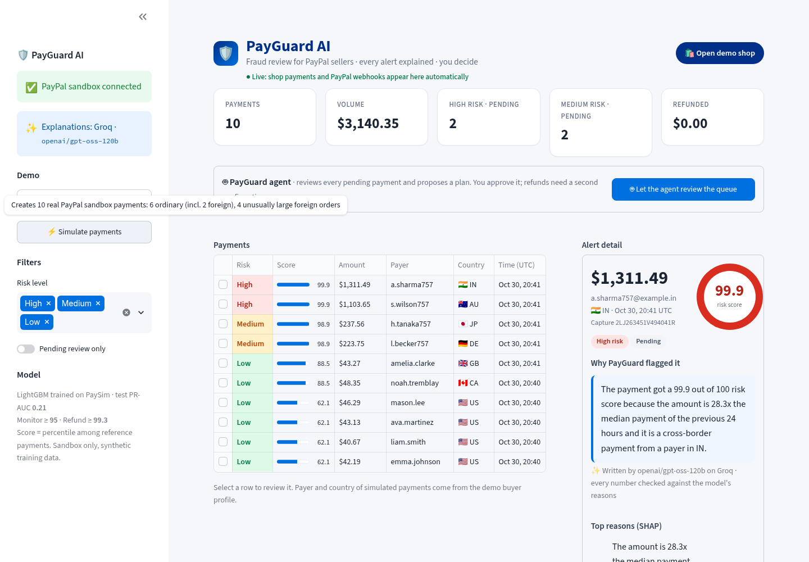 | 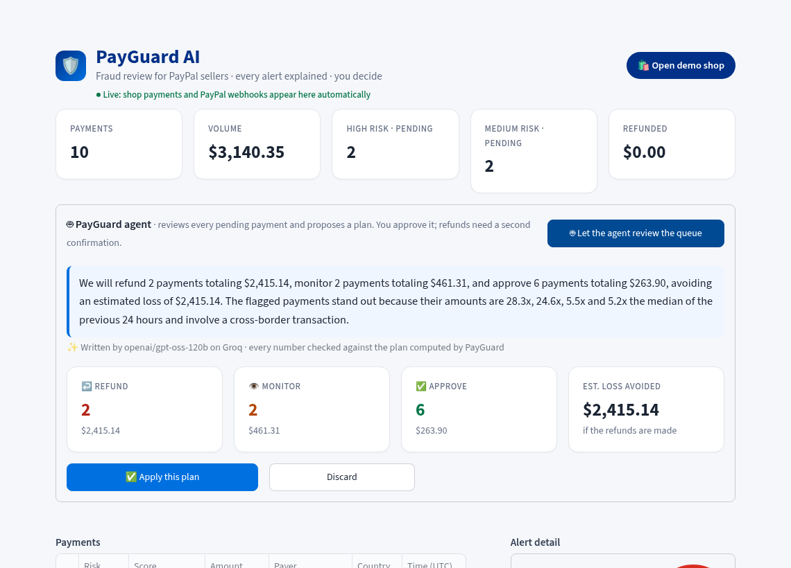 |

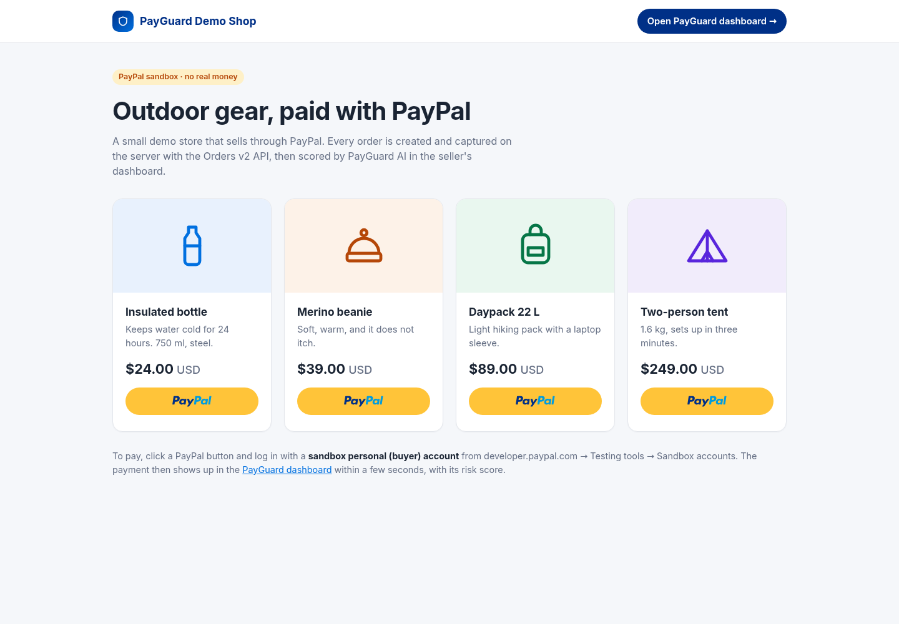

## Installation

Requires Python 3.11+.

```bash
python3 -m venv .venv
source .venv/bin/activate
pip install -r requirements.txt        # the app
pip install --no-deps -r requirements-toolkit.txt   # PayPal Agent Toolkit (see below)
pip install -r requirements-dev.txt    # optional: tests and retraining
cp .env.example .env                   # then fill in the values
```

| Variable | Required | Purpose |
|---|---|---|
| `PAYPAL_CLIENT_ID`, `PAYPAL_CLIENT_SECRET` | yes | a **sandbox** app from the PayPal developer dashboard |
| `PAYPAL_WEBHOOK_ID` | for webhooks | ID printed by `scripts/register_paypal_webhook.py`; without it every webhook is refused |
| `GROQ_API_KEY` | no | plain-English explanations (free key at console.groq.com); without it a template sentence is used |
| `GROQ_MODEL` | no | defaults to `openai/gpt-oss-120b` |
| `JUDGE_BUYER_EMAIL`, `JUDGE_BUYER_PASSWORD` | no | sandbox buyer login shown on `/shop/` for the judges; never a real account |

`.env` is listed in `.gitignore` and is never committed.

## Run

```bash
streamlit run server.py
```

Open http://localhost:8501 and click **⚡ Simulate payments** in the sidebar.
It creates 10 real sandbox card payments: 4 domestic regulars, 2 foreign
customers with a normal basket (CA, GB: still low, since being foreign is not
suspicious on its own), then 4 new foreign buyers with unusually large orders:
about 5x the usual ticket (DE, JP: medium) and 20x+ (AU, IN: high). Pick a payment
in the table to see its score, reasons and explanation, then click
**Approve**, **Monitor** or **Refund**. A refund asks for confirmation, then
calls PayPal.

Scores do not depend on the time of day, so the demo gives the same picture
whenever it runs. `tests/test_demo_levels.py` checks that the 10 demo payments
come out as 6 low, 2 medium and 2 high at 03:00, 12:00 and 22:00 UTC, on an
empty ledger and after 12 back-to-back demos in one day. Over 200 random demo
runs, low scores stay at or below 88.5, medium at 97.7–98.9 and high at 99.9 or
above. Six of the ten payments are ordinary on purpose: this keeps the 24 h
median ticket at the ordinary level when several people run the demo.

### PayPal checkout shop

Open http://localhost:8501/shop/ (or click **🛍️ Open demo shop** in the
dashboard). The shop sells 4 fixed-price items. Click a PayPal button and
approve with a PayPal **sandbox buyer** account. The JavaScript SDK renders the
button; the server creates the Orders v2 order from its own catalog (the
browser only sends a product id, never a price), checks the approved amount,
captures it, stores it in the ledger and returns the PayGuard score, which the
shop shows. **Open PayGuard dashboard** in the shop goes back to the seller view. The 6 low / 2 medium / 2 high **Simulate payments** demo
is unchanged.

Everything runs in **one process on one port**: `server.py` wraps the
dashboard in Streamlit's ASGI app (`st.App`, Streamlit 1.66+) and adds the
routes from `shop_api.py`: `/shop/`, `/api/shop/...` and `/webhooks/paypal`.
PayPal calls in those routes run in worker threads, so a slow PayPal response
never blocks the dashboard. This fits one free Render web service.

### Real-time PayPal webhooks

Register the sandbox webhook once, after deploying, with the same sandbox app
credentials as Render:

```bash
PAYGUARD_PUBLIC_URL=https://payguard-ai-1p86.onrender.com \
  python scripts/register_paypal_webhook.py
```

The script subscribes `PAYMENT.CAPTURE.COMPLETED` and
`PAYMENT.CAPTURE.REFUNDED` on `<url>/webhooks/paypal` and prints the webhook
ID (running it again reuses the same webhook). Put that ID in `.env` and in
Render as `PAYPAL_WEBHOOK_ID`; it is never in the code.

For every delivery, `/webhooks/paypal`:

1. refuses the event if `PAYPAL_WEBHOOK_ID` is not set (503) or the body is not JSON (400);
2. sends the PayPal transmission headers and the **raw** body to PayPal's
   `verify-webhook-signature` API, and refuses the event (400) unless PayPal
   answers `SUCCESS`, or (502) if PayPal cannot be reached;
3. stores the event id, so a redelivered event is applied once;
4. **capture completed**: adds the payment to the ledger if PayGuard did not
   make it itself (fetching the order for the payer's email and country), and
   marks it **✓ PayPal webhook** in the dashboard;
5. **capture refunded**: adds the refund once per PayPal refund id (a refund
   made from the dashboard is not counted twice). A full refund made directly
   in PayPal is logged as a refund decision, so it leaves the review queue.

The dashboard polls a fingerprint of the ledger every 3 seconds and reruns
when it changes: a shop checkout or a webhook shows up with its score and a
"New PayPal payment" notification, without clicking **Simulate payments** or
reloading the page.

## Deploy on Render (free)

The repo contains a `Dockerfile` (Python 3.11 slim + `libgomp1` for LightGBM)
and a `render.yaml` Blueprint for a free web service.

1. In Render, choose **New → Blueprint** and connect this GitHub repository.
2. Render reads `render.yaml` and asks for the secret values:
   `PAYPAL_CLIENT_ID`, `PAYPAL_CLIENT_SECRET`, `PAYPAL_WEBHOOK_ID`,
   `GROQ_API_KEY` (optional) and `JUDGE_BUYER_EMAIL` / `JUDGE_BUYER_PASSWORD`
   (optional, sandbox buyer shown on the shop page). Set the webhook ID after registering it above,
   then redeploy.
   `GROQ_MODEL` is preset.
3. Deploy. The app is served on the `onrender.com` URL Render gives you; the
   health check is `/_stcore/health`. The same port serves the dashboard
   (`/`), the shop (`/shop/`) and the webhook (`/webhooks/paypal`).
4. Register the webhook (see above), set `PAYPAL_WEBHOOK_ID`, redeploy.

Behaviour on the free plan:
- The service sleeps after ~15 minutes without traffic; the next visit takes
  about a minute to wake it.
- The disk is ephemeral: the ledger (`data/ledger.db`) starts empty after each
  deploy or restart. Click **⚡ Simulate payments** to create demo payments.
- **🧹 Reset demo** (sidebar, with a confirmation) empties the ledger for
  everyone: payments, refunds and decisions. It never calls PayPal; the
  sandbox keeps its payments. Processed webhook ids are kept, so a late
  redelivery cannot bring a deleted payment back.
- All visitors share one ledger, and anyone with the URL can trigger sandbox
  refunds. Only use sandbox credentials.
- Refunds fail with `REFUND_FAILED_INSUFFICIENT_FUNDS` when the sandbox
  business account's balance is lower than the refund (each demo run refunds
  up to ~$3,000). Keep a large balance on that sandbox account. Any refund
  PayPal refuses is shown as a short, plain message (the PayPal error code is
  in small print below), nothing is recorded as refunded, and the payment stays
  in the queue.
- **Simulate payments** needs card processing on the sandbox business
  account; if PayPal answers `PAYEE_NOT_ENABLED_FOR_CARD_PROCESSING`, enable
  card payments for the sandbox app/account in the PayPal developer dashboard.

The app runs as one process and uses about 250 MB of RAM with the model
loaded and a dashboard open, within the free plan's 512 MB.

## Ask PayGuard: an LLM agent with tools

The seller types a question or an instruction in **💬 Ask PayGuard** (or
clicks an example). An LLM on Groq (`openai/gpt-oss-120b`, function calling)
decides which tools to call, reads the results and answers in a few
sentences. Code: `payguard/copilot.py`.

| Tool | Source | What it returns |
|---|---|---|
| `list_payments` | PayGuard ledger | payments with amount, item, score, level, status, cross-border flag |
| `get_payment_risk` | PayGuard model | score, level, proposed action and the SHAP reasons of one payment |
| `get_order_details` | **PayPal Agent Toolkit** | the PayPal order: status, items, captures |
| `list_disputes` | **PayPal Agent Toolkit** | disputes opened by buyers |
| `prepare_refund` | PayGuard | a refund *proposal*: a button for the seller, no money moves |

The dashboard shows every step live (tool, arguments, one-line result; the
full result in the **Agent steps** panel), with a badge on the toolkit tools.

**Guardrails**

- **No tool moves money.** `prepare_refund` only adds a proposal. The refund
  runs when the seller clicks **Review & refund** and then **Yes, refund** in
  the same confirmation dialog as a manual refund; it is logged with the
  source `copilot`.
- **Allowlist.** The model only gets the five tools above. Any other tool name
  (`pay_order`, `create_order`, `accept_dispute_claim`…) is refused without
  running, and the toolkit wrapper itself refuses any method but
  `get_order_details` and `list_disputes`.
- **Limits.** At most 6 model calls and 10 tool calls per question, 5 refund
  proposals, 20 s per toolkit call. On the last step the tools are withdrawn
  so the model must answer.
- **Numbers checked**, as for the explanations: every number in the answer
  must appear in the question or in a tool result, and the answer may only
  say a refund is prepared if `prepare_refund` really proposed one. Otherwise
  the model gets one retry with the problem spelled out, then a template answer
  built from the tool results is shown. The UI says which of the two you see.
- **No country, no names.** Tool results never contain the payer's country,
  name or email (orders from the toolkit are stripped of payer and shipping
  data), only a cross-border flag. Tool results are passed as data, and the
  model is told not to follow instructions found in them.
- **Rate limits.** Groq's free tier allows 8,000 tokens per minute; on HTTP 429
  the agent waits as long as Groq asks (at most 8 s) and retries twice.

**Why the toolkit is installed with `--no-deps`.** We checked PayPal's
documentation and the package: `paypal-agent-toolkit` 1.11.0 (Python ≥ 3.11)
ships adapters for the OpenAI Agents SDK, LangChain, CrewAI and Bedrock, and
pins `openai-agents==0.0.2`, `langchain==0.3.23` and `crewai-tools==0.13.2`.
PayGuard uses none of those frameworks: it calls the toolkit's framework-free
layer (`paypal_agent_toolkit.shared.api.PayPalAPI`, which needs only
`requests`, `pydantic` and `httpx`) from its own Groq function-calling loop.
Installing it without dependencies keeps the image small enough for Render's
free plan. The toolkit has no tool to refund an order capture, so refunds stay
on PayGuard's own client, behind the seller's confirmation. Without the
package, Ask PayGuard still works with PayGuard's tools only.

**Seen on the real sandbox:** *Review today's payments and protect me from
fraud* → `list_payments`, `get_payment_risk` ×2, `prepare_refund` ×2, and two
refund buttons; *Why was the tent order flagged?* → `list_payments`,
`get_payment_risk`, answer from the SHAP reasons ("5.0x the median payment of
the last 24 hours and cross-border"); *Do I have any open disputes?* →
`list_disputes` (toolkit); *Show me the PayPal order of the tent purchase* →
`get_order_details` (toolkit).

## Tests

```bash
pytest -q                               # offline: client, model, explanations, agent, Ask PayGuard, shop, webhooks, UI
python scripts/paypal_smoke_test.py     # live sandbox: auth, order, capture, refund
```

The UI tests drive `app.py` headlessly with Streamlit's `AppTest`, using mocked
PayPal and Groq clients. They check, for example, that a refund never reaches
PayPal before the seller confirms, including refunds in an agent plan and
refunds proposed by Ask PayGuard. `tests/test_copilot.py` scripts the LLM's
tool calls to check each guardrail: no refund without confirmation, unknown
or money-moving tools refused, step and tool-call limits, invented numbers and
false "refund prepared" claims rejected, no country or payer data in tool
results, and the toolkit still offering the methods PayGuard calls. The shop
and webhook routes are tested over HTTP (forged, unverifiable and duplicate
webhooks, amounts changed after approval), and `tests/test_server.py` starts
`server.py` as the Dockerfile does and checks that one port serves the
dashboard, the shop and the webhook.

## Architecture

```
 Buyer (sandbox account)                       PayPal sandbox REST API
 ┌──────────────────────┐  create / capture   ┌──────────────────────────────────┐
 │ /shop/  Demo Shop    │────(Orders v2)─────►│ orders · captures · refunds       │
 │ PayPal JS SDK buttons│                     │ verify-webhook-signature          │
 └──────────┬───────────┘                     └──────┬──────────────▲────────────┘
            │                           webhooks     │              │ refund, only after
            │             CAPTURE.COMPLETED/REFUNDED │              │ seller confirms
 ┌──────────▼────────────────────────────────────────▼──────┐       │
 │ server.py: one process, one port (st.App)                 │       │
 │  shop_api.py  /shop/ · /api/shop/* · /webhooks/paypal     │       │
 │  app.py       Streamlit dashboard (/), live every 3 s     │───────┘
 └──────────┬───────────────────────────────┬────────────────┘
            │                               │
 ┌──────────▼───────────┐       ┌───────────▼──────────────────────────────┐
 │ payguard/ledger.py   │◄─────►│ payguard/agent.py                        │
 │ SQLite: payments,    │       │ review → propose → execute(confirmed)    │
 │ refunds, decisions,  │       │ plan_queue → summarize → apply_plan      │
 │ webhook events       │       └───────┬───────────────────┬──────────────┘
 └──────────────────────┘               │ features          │ facts
                              ┌─────────▼────────┐  ┌───────▼──────────────────┐
                              │ payguard/risk.py │  │ payguard/explain.py      │
                              │ LightGBM → 0-100 │  │ SHAP reasons, Groq text, │
                              └──────────────────┘  │ number check, templates  │
                                                    └──────────────────────────┘
```

| Module | Role |
|---|---|
| `server.py` | entry point: the dashboard plus the shop and webhook routes on one port |
| `shop_api.py` | demo shop page, Orders v2 create/capture, verified webhook receiver |
| `templates/shop.html` | shop page (PayPal JavaScript SDK buttons) |
| `app.py` | Streamlit dashboard: list, detail, decisions, agent plan, live updates |
| `payguard/paypal_client.py` | OAuth, orders, refunds, webhooks (verify, register), Transaction Search |
| `payguard/ledger.py` | local record of payments, refunds, webhook events and decisions (audit log) |
| `payguard/features.py` | features shared by training (PaySim) and inference (ledger) |
| `payguard/risk.py` | loads the model, turns probabilities into 0–100 scores and levels |
| `payguard/explain.py` | SHAP reasons, Groq sentences, number check, templates |
| `payguard/agent.py` | proposals per payment and for the whole queue; executes only on seller confirmation |
| `payguard/copilot.py` | Ask PayGuard: Groq function-calling loop, tool allowlist, PayPal Agent Toolkit wrapper, guardrails |
| `payguard/simulate.py` | creates the demo sandbox payments |
| `scripts/` | dataset download, training, PayPal smoke test, webhook registration |

## Explanations

SHAP values come from LightGBM's built-in TreeSHAP (`pred_contrib=True`), which
is exact for tree models and needs no extra dependency. Up to 3 reasons are
shown: the features that pushed the score up the most, then, for a low-risk
payment, the features that pulled it down. A feature with zero effect on the
score is never presented as a reason. With the current model only the amount
and the cross-border flag have an effect (see limitations), so alerts show 2 reasons.

The LLM receives only the score and the reasons as text, and is asked to
copy numbers exactly. The reasons it receives say "cross-border" or
"domestic", never which country. Before a sentence is shown, every number in
it, whether written in digits ("22.5") or in words ("twenty"), must appear in
those facts; the sentence may not name another risk level than the payment's
(e.g. "high risk" for a medium alert); and it may not name a country, a
nationality or where the payer is (country codes such as "IN", names such as
"India" or "Indian", or "a payer in…"). If not, PayGuard retries once and then falls back to a fill-in-the-blanks
template, which is also used with no `GROQ_API_KEY` or on any API error. The UI
labels which of the two produced the sentence.

## Agent and seller validation

| Risk level | Score | Proposal |
|---|---|---|
| low | < 95.0 | Approve |
| medium | 95.0 – 99.3 | Monitor (hold or watch before shipping) |
| high | ≥ 99.3 | Refund |

The agent only proposes. `PayGuardAgent.execute()` refuses to act without
`seller_confirmed=True`. In the UI, Approve and Monitor are recorded locally;
Refund opens a confirmation dialog and then refunds the remaining amount
through PayPal. The seller can always pick a different action than the
proposal. A refunded payment cannot be changed. Every decision is logged with
the score, the proposal and the PayPal refund id.

## Agent: review the whole queue

**🤖 Let the agent review the queue** (above the payment list) plans every
payment still waiting for a decision, for example: *"2 payments to refund, 2
to monitor, 6 to approve. Estimated loss avoided: $2,645.02."*

- **The code computes every number**: `PayGuardAgent.plan_queue()` takes the
  proposal of each pending payment (refund / monitor / approve, from its risk
  level), counts them and adds up the amounts still captured. *Estimated loss
  avoided* is the amount of the payments proposed for refund: the money that
  would be lost to chargebacks if they are fraudulent.
- **The LLM only writes the summary** (2 sentences, Groq) from those facts and
  the reasons of the flagged payments. As for alert explanations, every number
  in its text must appear in the facts, otherwise PayGuard retries once and
  falls back to a template. The reasons given to it say "cross-border", never
  which country.
- **One click to apply**: **✅ Apply this plan** records the approvals and
  monitors at once. If the plan has refunds, a second dialog lists them
  (amount, payer, score) and refunds only on **Yes, refund them**; **Not now**
  leaves them in the queue. Payments decided since the plan was made are left
  alone, and one PayPal failure does not stop the others.
- **Every decision is logged** in the `decisions` table with its source:
  `seller` (manual), `agent_plan` (approved plan), `copilot` (proposed by Ask
  PayGuard, confirmed by the seller) or `paypal` (refunded directly in PayPal,
  seen by webhook). The decision history of each payment
  shows it.

## Risk model

The trained model ships in `models/` (`payguard_lgbm.txt`, ~0.05 MB, plus
`model_meta.json` with thresholds and metrics), so the app runs without the
dataset. To retrain:

```bash
python scripts/download_paysim.py   # ~470 MB, checksum-verified
python scripts/train_model.py       # ~1 min, rewrites models/
```

**Features**, chosen because a PayPal seller can compute them from their own
payment history:

| Feature | Meaning |
|---|---|
| `amount_ratio` | amount / median payment over the previous 24 h (scale-free) |
| `payer_txn_24h` | payments by the same payer in the previous 24 h |
| `payer_is_new` | 1 if the payer has never paid before |
| `cross_border` | 1 if the payer's country differs from the seller's (simulated for training, see below) |

The hour of day is deliberately **not** a feature (see limitations).

LightGBM, with monotone constraints: risk can only increase with the amount
ratio, with payer velocity, and for a new payer.

**Risk score (0–100)** is the percentile of the model's fraud probability among
the validation payments: 97 means "riskier than 97% of reference payments".
Thresholds: **monitor ≥ 95.0** (top 5% of validation payments, a review budget)
and **refund ≥ 99.3** (the threshold that maximises F1 on validation).

**Evaluation**: temporal split on PaySim's hourly `step`. Validation is used
only for early stopping and thresholds; the numbers below are on the test window.

| Split | Steps (hours) | Rows | Frauds |
|---|---|---|---|
| train | 1–400 | 2,529,536 | 4,477 |
| validation | 401–550 | 158,652 | 1,588 |
| test | 551–743 | 82,221 | 2,148 |

| Test metric | With `cross_border` | Without `cross_border` |
|---|---|---|
| PR-AUC (baseline = prevalence 0.026) | **0.213** | 0.163 |
| Precision / recall / F1 at refund threshold | 0.46 / 0.19 / 0.27 | 0.42 / 0.15 / 0.22 |
| Precision / recall / F1 at monitor threshold | 0.21 / 0.37 / 0.27 | 0.18 / 0.36 / 0.24 |

These numbers are modest, and two earlier versions scored higher on paper.
One used the hour of day (0.441 PR-AUC), which was mostly a simulator artifact
and made scores depend on when the app was opened. The other used a
per-country variable (0.265), whose extra gain came only from assumed
per-country fraud rates. Both were dropped.

Accuracy is not reported: with 0.2–2.6% fraud, it is meaningless.

## Data & limitations

- **Dataset.** [PaySim](https://www.kaggle.com/datasets/ealaxi/paysim1)
  (Lopez-Rojas et al., 2016) is a *synthetic* mobile-money dataset generated
  from one month of real logs: 6.36M transactions, 8,213 frauds. It is downloaded
  from a public Hugging Face mirror and checked against a fixed SHA-256.
- **Only `TRANSFER` and `CASH_OUT`.** PaySim contains fraud only in these two
  types, so the model is trained on them alone.
- **Balances are not used.** PaySim's balance columns are very predictive, but
  a seller never sees the payer's balance, so using them would not transfer to
  PayPal.
- **Amounts are relative.** PaySim amounts use an unspecified currency at a
  different scale from a typical PayPal checkout, so the model only sees the
  amount relative to the recent median ticket.
- **Country is a cross-border signal, not a judgment on nationality.** The
  model only knows whether the payer's country differs from the seller's; every
  foreign country is treated the same, and a foreign buyer with a normal basket
  stays low risk. A payment is flagged when cross-border meets an abnormal
  amount, and the seller always makes the final decision. The app shows the
  country for the seller's information, but the model never sees which
  country it is, and no sentence written by PayGuard names it: the
  explanation, the queue summary and Ask PayGuard's answers say
  "cross-border" and are rejected if they name a country. An explanation
  cached before this check is written again.
- **Cross-border is simulated.** PaySim has no geography. Each training
  transaction is marked cross-border at random (fixed seed): 20% of legitimate
  payments and 50% of fraudulent ones, for a US seller. These shares are
  **assumptions** (see `CROSS_BORDER_SHARE` in `payguard/features.py`), loosely
  based on the common observation that cross-border payments carry more fraud.
  They are **not measured data**, which is why the table above also shows
  metrics without `cross_border`: it adds about +0.05 PR-AUC, and that gain is
  synthetic by construction. A payer with no known country counts as domestic.
- **Payer history carries no signal in PaySim.** Payers almost never repeat
  (at most 3 transactions per payer; 460 training rows have a payment in the
  previous 24 h). The model therefore does not use `payer_txn_24h` and
  `payer_is_new` in practice (their SHAP values are exactly 0, so they never
  appear as reasons). They are kept, with monotone constraints, so that
  retraining on real seller history can use them.
- **No hour of day.** In PaySim, fraud is spread evenly over the day while
  legitimate volume collapses at night, so the hour looked extremely predictive
  (it carried ~60% of an earlier model's gain). That is mostly a simulator
  artifact. It also made the same payment score "low" at noon and "high" at
  night UTC, which is wrong for a seller reviewing payments at any hour. The
  feature was removed: test PR-AUC dropped from 0.441 to 0.265, and scores no
  longer depend on the time of day. The model now effectively relies on two
  signals, the relative amount and the (simulated) cross-border flag.
- **Drift.** PaySim's legitimate volume drops sharply after step ~400, so fraud
  prevalence goes from 0.18% (train) to 2.6% (test). That is why the score is a
  percentile, not a raw probability.
- **Transaction Search.** PayPal's `/v1/reporting/transactions` needs the
  "Transaction search" option on the app, and sandbox data can lag by hours.
  PayGuard therefore keeps a local SQLite ledger (`data/ledger.db`) of every
  order, capture and refund it makes, and uses that as the primary source.
- **Demo buyer profiles.** Card payments in the sandbox carry no payer email,
  and PayPal does not return the card's billing country. For simulated
  payments, the payer email and country shown in the app come from the demo
  buyer profile used to create the payment, which is also the card's billing
  country.
- **LLM sentences** can still be awkward or vague. The number check only
  guarantees that they contain no number absent from the model's reasons.
- **Ask PayGuard** can pick the wrong tools or miss a payment, and the number
  check cannot tell whether a correct number is attached to the right payment.
  It only proposes; the seller decides. On Groq's free tier, several questions
  in a row can be slowed down by the tokens-per-minute limit.

This is a hackathon prototype trained on synthetic data. It is not a production
fraud model.
